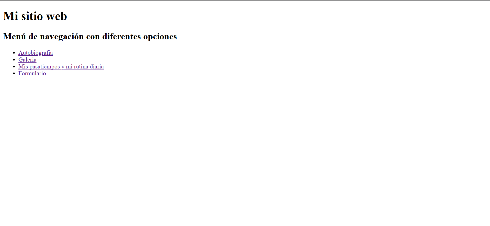
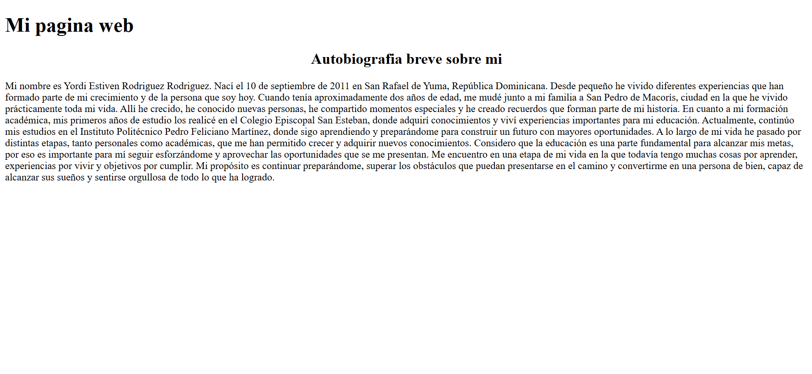
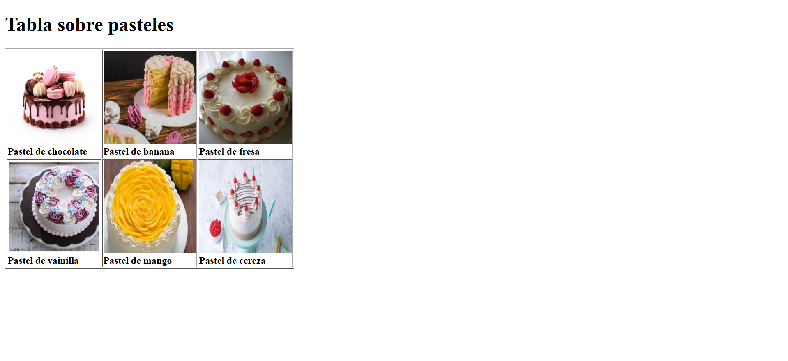

Proyecto de desarollar un sitio web con distintos elementos

Nombre del autor:Yordi Estiven Rodriguez Rodriguez

Curso/seccion:4to D Informatica

Descripcion breve del sitio web:Este es un sitio web con una pagina de incio donde tienes un menu con diferentes opciones,donde puedes ir a mi Autobiografia,una galeria con diferentes imagenes en tablas,una pagina de mis pasatiempos y mi rutina diaria y por ultimo un formulario con diferentes opciones para rellenar.

#Mi sitio web 

## Pagina principal

## Pagina de autobiografia

## Pagina de Galeria

## Pagina de Mis pasatiempos y mi rutina

[Rutina](Rutina.png)

## Pagina de Formulario

[Formulario](Formulario.png)

